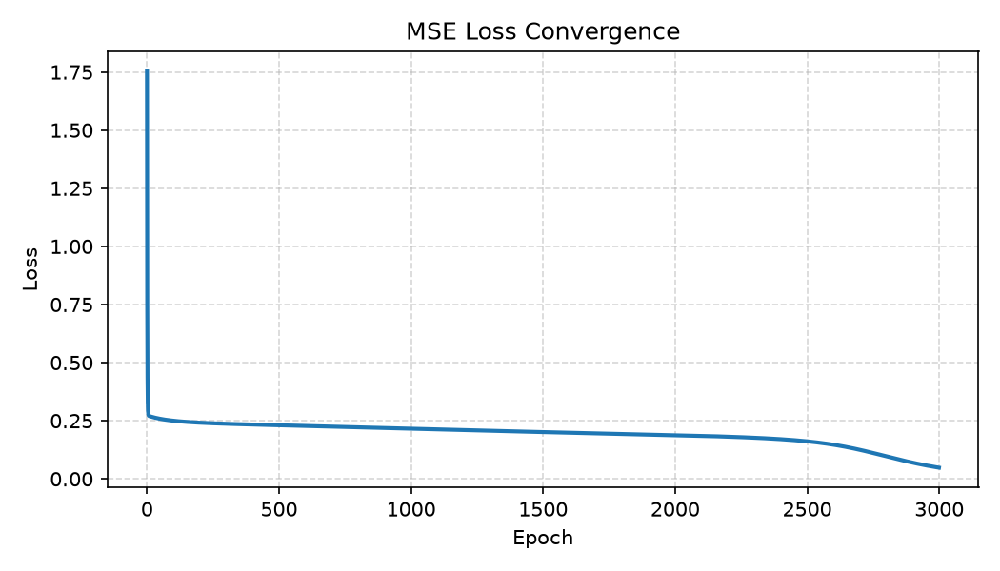

# Inside the Backward Pass: Neural Network Engine from Scratch

[](https://www.python.org/)
[](https://numpy.org/)
[](LICENSE)
[-brightgreen.svg)]()
[]()

A lightweight, modular neural network library built strictly from scratch using **NumPy** (no PyTorch, TensorFlow, or autograd packages). Designed to demystify and rigorously prove the mechanics of forward propagation, reverse automatic differentiation (backpropagation), and gradient descent optimization.

---

## 📋 Table of Contents

- [Project Purpose](#-project-purpose)
- [System Architecture](#-system-architecture)
- [Project Structure](#-project-structure)
- [Installation](#-installation)
- [How to Run](#-how-to-run)
  - [1. Model Training & Decision Boundary Demo](#1-model-training--decision-boundary-demo)
  - [2. Numerical Gradient Verification (Phase 3)](#2-numerical-gradient-verification-phase-3)
  - [3. Hand-Trace Verification (Phase 1)](#3-hand-trace-verification-phase-1)
- [Mathematical Summary](#-mathematical-summary)
- [Experimental Results](#-experimental-results)
- [Documentation](#-documentation)
- [License](#-license)

---

## 🎯 Project Purpose

Modern deep learning frameworks abstract away derivative calculations behind black-box `.backward()` calls. The primary objectives of this capstone project are:

1. **Build a Modular Engine:** Implement foundational components (`Linear`, `Sigmoid`, `ReLU`, `Tanh`, `MSELoss`, `BCELoss`, `Network`) adhering to standard object-oriented layer interfaces.
2. **Prove Gradient Correctness:** Rigorously validate analytical backpropagation gradients against symmetric two-sided finite difference approximations, ensuring relative errors strictly satisfy:
   $$\text{Relative Error} < 10^{-6}$$
3. **Solve Non-Linearly Separable Problems:** Demonstrate that a 2-layer network (2 inputs $\rightarrow$ 2 hidden neurons with Sigmoid $\rightarrow$ 1 output) learns non-linear decision boundaries on datasets that linear models cannot separate (XOR).

---

## 🏛 System Architecture

The engine coordinates computation through a sequential layer container that maintains the fundamental invariant of backpropagation:

```
[Forward Pass: 0 -> N-1]
Input X ──► Linear Layer ──► Sigmoid Activation ──► Linear Layer ──► MSE Loss

[Backward Pass: N-1 -> 0]
Input Grad ◄── Linear Layer ◄── Sigmoid Derivative ◄── Linear Layer ◄── dL/dŷ
```

- **Forward:** Each layer takes inputs, computes affine or non-linear outputs, and caches activations required for derivative calculation.
- **Backward:** Layers consume upstream gradients from right-to-left, evaluate parameter gradients ($\frac{\partial L}{\partial W}, \frac{\partial L}{\partial b}$), and pass input gradients back upstream.

---

## 📁 Project Structure

```text
Simple-Neural-Network/
├── nn/                         # Core library package
│   ├── __init__.py             # Public API exports
│   ├── linear.py               # Fully connected affine layer
│   ├── activations.py          # Sigmoid, ReLU, Tanh activation modules
│   ├── losses.py               # MSELoss, BCELoss objective criteria
│   └── network.py              # Sequential container (forward/backward)
├── docs/                       # Technical & architectural specifications
│   ├── architecture.md         # Engine architecture & design specifications
│   ├── mathematics.md          # Complete mathematical derivations
│   └── verification.md         # Gradient verification & validation protocol
├── data.py                     # Synthetic XOR & Two Moons dataset generators
├── trainer.py                  # SGD optimization & training loop
├── main.py                     # End-to-end model training & boundary visualization
├── grad_check.py               # Finite-difference numerical gradient checker
├── verify_hand_trace.py        # Concrete single-sample hand-trace verification
├── .gitignore                  # Git configuration
└── LICENSE                     # Project license
```

---

## 🚀 Installation

Ensure Python 3.8+ is installed. Clone the repository and install the standard dependencies:

```bash
git clone https://github.com/abelmekonen/Simple-Neural-Network.git
cd Simple-Neural-Network
pip install numpy matplotlib
```

*(Note: Matplotlib is used solely for plotting final decision boundary contours; the neural network engine itself relies strictly on NumPy.)*

---

## 💻 How to Run

### 1. Model Training & Decision Boundary Demo

Train the 2-2-1 network on the non-linear XOR dataset:

```bash
python main.py
```

**Output:**
- Displays loss and classification accuracy per epoch.
- Exports `loss.png` (training convergence curve).
- Exports `decision_boundary.png` (2D non-linear contour plot).

### 2. Numerical Gradient Verification (Phase 3)

Verify analytical backpropagation gradients against two-sided finite difference approximations:

```bash
python grad_check.py
```

Computes relative error:
$$\text{RelError} = \frac{|g_{\text{analytical}} - g_{\text{numerical}}|}{\max(10^{-8}, |g_{\text{analytical}}| + |g_{\text{numerical}}|)}$$

All parameters achieve relative errors $< 10^{-10}$, well surpassing the $10^{-6}$ passing threshold.

### 3. Hand-Trace Verification (Phase 1)

Compare exact numerical values against manual paper calculations for a deterministic single-sample forward and backward pass:

```bash
python verify_hand_trace.py
```

---

## 📐 Mathematical Summary

| Component | Forward Equation | Backward Derivative |
| :--- | :--- | :--- |
| **Linear Layer** | $z = XW^T + b$ | $\frac{\partial L}{\partial W} = G^T X, \quad \frac{\partial L}{\partial b} = \sum G, \quad \frac{\partial L}{\partial X} = G W$ |
| **Sigmoid** | $\sigma(z) = \frac{1}{1 + e^{-z}}$ | $\sigma'(z) = \sigma(z)(1 - \sigma(z))$ |
| **ReLU** | $f(z) = \max(0, z)$ | $f'(z) = \mathbb{I}(z > 0)$ |
| **Tanh** | $\tanh(z) = \frac{e^z - e^{-z}}{e^z + e^{-z}}$ | $\tanh'(z) = 1 - \tanh^2(z)$ |
| **MSE Loss** | $L = \frac{1}{N}\sum (\hat{y} - y)^2$ | $\frac{\partial L}{\partial \hat{y}} = \frac{2}{N}(\hat{y} - y)$ |

For complete derivations and matrix calculus notes, see [docs/mathematics.md](docs/mathematics.md).

---

## 📊 Experimental Results

On the continuous 2D XOR benchmark (300 samples, noise $\sigma = 0.08$):

| Loss Convergence | Learned Decision Boundary |
| :---: | :---: |
|  |  |
| *Smooth MSE loss reduction across 3,000 epochs* | *Non-linear boundary separating XOR classes at 0.5 threshold* |

* **Initial MSE Loss:** `1.7534` (50.00% random accuracy)
* **Final MSE Loss:** `0.0482`
* **Final Classification Accuracy:** **100.00%**
* **Non-Linear Separation:** As visualized above, the 2 hidden sigmoid units successfully warp the input feature space, learning a non-linear closed contour at the 0.5 threshold that cleanly separates both classes. A single linear perceptron cannot achieve this.

---

## 📖 Documentation

Detailed technical references are located in the `docs/` folder:
- [Architecture Specifications](docs/architecture.md)
- [Mathematical Formulations](docs/mathematics.md)
- [Verification & Validation Protocol](docs/verification.md)

---

## 📄 License

This project is licensed under the MIT License — see the [LICENSE](LICENSE) file for details.

