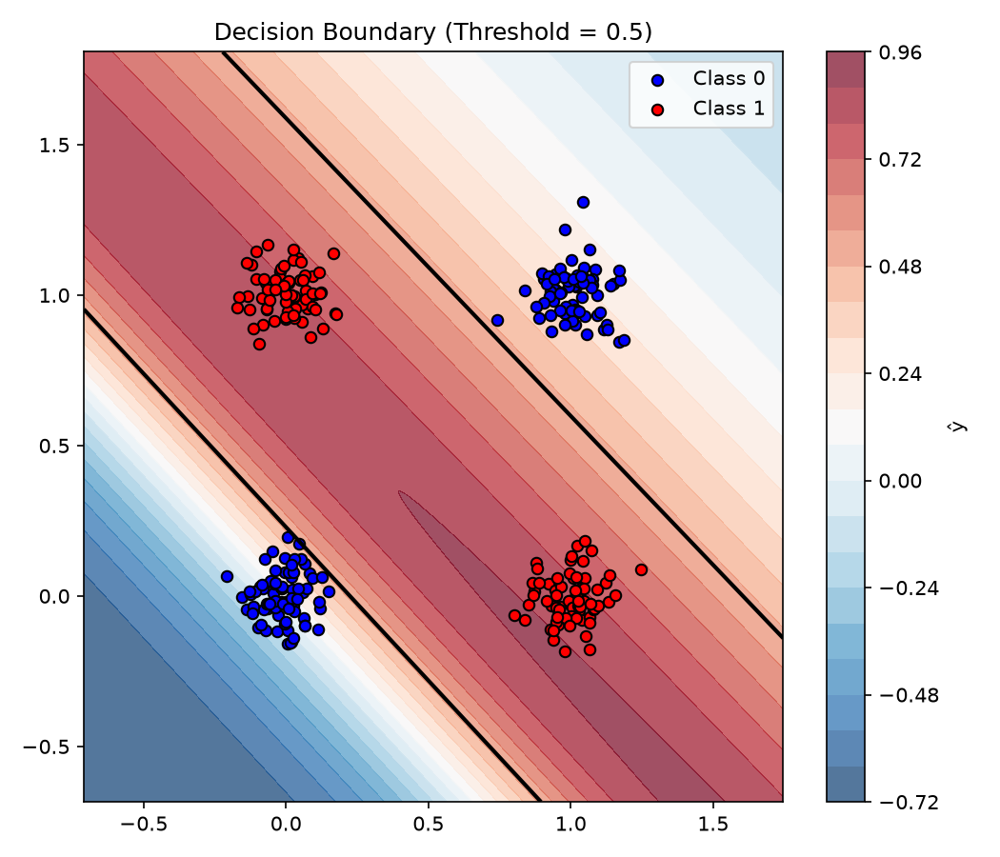

# Simple Neural Network — From Scratch

[](https://www.python.org/)
[](LICENSE)

A small neural network library built from scratch using only NumPy, as part of a capstone project on understanding backpropagation. No PyTorch, no TensorFlow, no autograd — just math and code.

---

## Table of Contents

- [What This Is](#what-this-is)
- [Project Structure](#project-structure)
- [Installation](#installation)
- [How to Run](#how-to-run)
- [How It Works](#how-it-works)
- [Results](#results)
- [Docs](#docs)
- [License](#license)

---

## What This Is

When you call `loss.backward()` in PyTorch, a lot happens under the hood that most people never see. This project is about opening that black box.

I built every piece of the library by hand:
- A `Linear` layer that computes `z = Wx + b` and knows how to backpropagate through itself
- Activation functions (`Sigmoid`, `ReLU`, `Tanh`) with their own derivative implementations
- Loss functions (`MSELoss`, `BCELoss`) that kick off the backward pass
- A `Network` class that chains layers together and runs forward/backward in the right order
- A `Trainer` that runs gradient descent to update weights

The network is then trained on an XOR dataset — a classic problem that a straight line can't solve but a network with one hidden layer can.

As a final check, every computed gradient is verified numerically by slightly nudging each weight and observing the change in loss. All gradients pass.

---

## Project Structure

```
Simple-Neural-Network/
├── nn/
│   ├── __init__.py        # Package exports
│   ├── linear.py          # Linear layer (forward + backward)
│   ├── activations.py     # Sigmoid, ReLU, Tanh
│   ├── losses.py          # MSELoss, BCELoss
│   └── network.py         # Sequential network container
├── docs/
│   ├── architecture.md    # System design overview
│   ├── mathematics.md     # Math behind each layer
│   └── verification.md    # How gradient checking works
├── assets/
│   ├── loss.png
│   └── decision_boundary.png
├── data.py                # XOR and Two Moons dataset generators
├── trainer.py             # Training loop and SGD optimizer
├── main.py                # Runs the full training demo
├── grad_check.py          # Numerical gradient verification
└── verify_hand_trace.py   # Matches code output to paper calculations
```

---

## Installation

```bash
git clone https://github.com/abelmekonen/Simple-Neural-Network.git
cd Simple-Neural-Network
pip install numpy matplotlib
```

Matplotlib is only used for the plots. The network itself runs on NumPy alone.

---

## How to Run

**Train the network and generate plots:**
```bash
python main.py
```

**Verify gradients numerically:**
```bash
python grad_check.py
```

**Compare code output against hand calculations (Phase 1):**
```bash
python verify_hand_trace.py
```

---

## How It Works

The network is small by design — 2 inputs, 2 hidden neurons with Sigmoid, 1 output:

```
x = [x1, x2]
       │
   [Linear]      z1 = W1·x + b1
       │
   [Sigmoid]     a1 = 1 / (1 + e^-z1)
       │
   [Linear]      ŷ  = W2·a1 + b2
       │
   [MSELoss]     L  = mean((ŷ - y)²)
```

**Forward pass:** data flows left to right, each layer computes its output and caches what it needs for the backward step.

**Backward pass:** gradients flow right to left through the same layers in reverse order. Each layer multiplies the incoming gradient by its local derivative — this is the chain rule applied in code.

**Parameter update (SGD):**
```
W = W - learning_rate * dW
b = b - learning_rate * db
```

---

## Results

Trained on XOR (300 points, 3000 epochs, lr=0.1):

| Loss Curve | Decision Boundary |
| :---: | :---: |
|  |  |

The network converges from random guessing (50%) to **100% accuracy**. The decision boundary plot shows the non-linear boundary the hidden layer learned — something no linear model could draw.

---

## Docs

- [Architecture overview](docs/architecture.md)
- [Math for each layer](docs/mathematics.md)
- [Gradient verification explained](docs/verification.md)

---

## License

MIT
